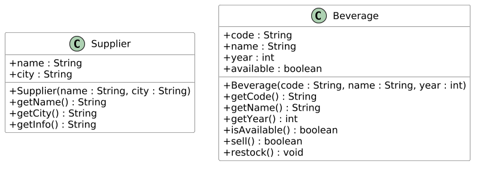
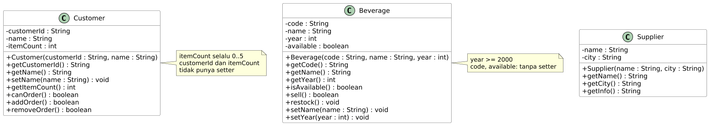
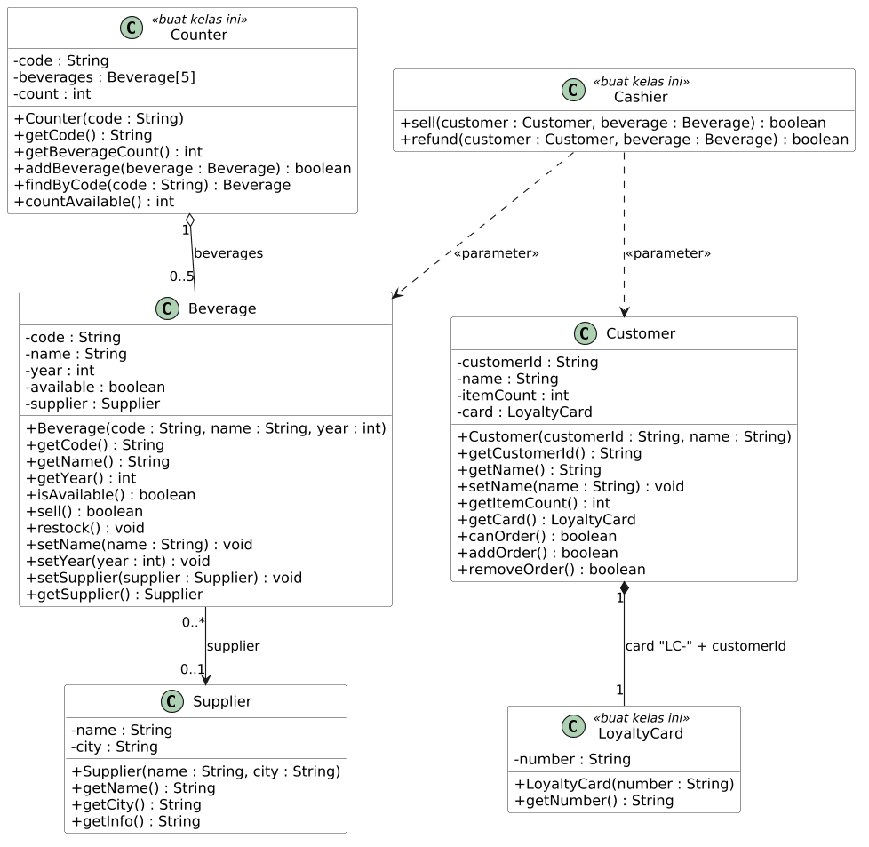
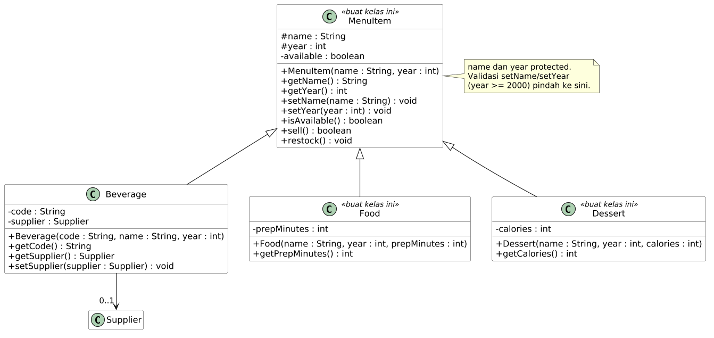
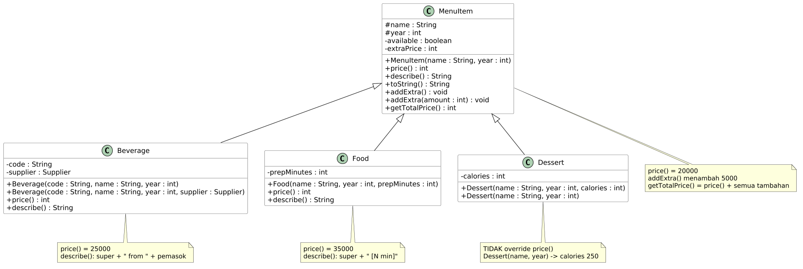
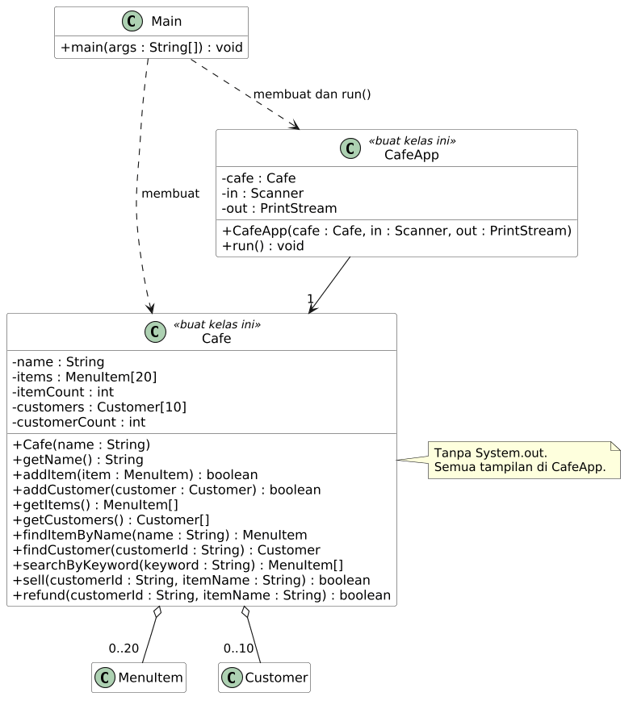

# UTS PBO Varian C: Pemesanan Kafe

## Aturan

- Jangan ubah `src/test/**`, `.github/**`, dan `.wakatime-project`.
- Ikuti diagram persis: nama kelas, field, constructor, dan method.
- Buat semua field `private`, kecuali `name` dan `year` di `MenuItem` (`protected`).
- Pakai array biasa. Jangan pakai `List` atau `ArrayList`.
- Jangan pakai `System.out.println` di `Cafe` dan kelas model. Tampilan hanya di `Main` dan `CafeApp`.
- Nyalakan WakaTime setiap kali mengerjakan (lihat Langkah 0).
- Kerjakan sendiri tanpa bantuan AI. Jangan memakai AI (chatbot, asisten kode, atau autocomplete berbasis AI) untuk menulis kode, menjawab soal, atau menyusun laporan. Kode, video, dan laporan harus hasil kerjamu, dan kamu menjelaskan kodemu langsung di video. Kode atau laporan salinan tidak dinilai.

## Langkah 0: Pasang WakaTime (wajib, sebelum menulis kode apa pun)

1. Buat akun gratis di [wakatime.com](https://wakatime.com), lalu salin API key dari [wakatime.com/settings/api-key](https://wakatime.com/settings/api-key). Jangan bagikan key ini.
2. Pasang plugin di editormu (NetBeans: `Tools > Plugins`; VS Code: ekstensi `WakaTime`; IntelliJ IDEA: `Settings > Plugins`), lalu tempel API key.
3. Ketik kode beberapa menit, buka [wakatime.com/dashboard](https://wakatime.com/dashboard), dan pastikan project **uts-c-kafe** muncul.

`.wakatime-project` berisi `uts-c-kafe`. Jangan ubah atau hapus. Waktu pengerjaan tanpa plugin tidak dihitung.

## Daftar Isi

1. [Aturan](#aturan) dan [Langkah 0](#langkah-0-pasang-wakatime-wajib-sebelum-menulis-kode-apa-pun)
2. [Studi Kasus](#studi-kasus), [Memulai](#memulai), [Cara Membaca Diagram](#cara-membaca-diagram)
3. [Bagian 1](#bagian-1-pengantar) sampai [Bagian 7](#bagian-7-aplikasi-konsol)
4. [Video Penjelasan](#video-penjelasan-wajib)
5. [Laporan Singkat](#laporan-singkat-pdf-2-3-halaman), [Pengumpulan](#pengumpulan), [Penilaian](#penilaian)

## Studi Kasus

Polinema Cafe menjual tiga jenis menu:

- **Minuman** (`Beverage`): harga dasar Rp25.000, punya kode dan pemasok (`Supplier`).
- **Makanan** (`Food`): harga Rp35.000, punya waktu persiapan dalam menit.
- **Dessert** (`Dessert`): memakai harga dasar menu Rp20.000, punya kalori.

Setiap **pelanggan** punya kartu loyalty dan boleh memesan paling banyak **5** item per pesanan. Kasir memakai aplikasi konsol untuk menambah menu, mendaftarkan pelanggan, menjual, memproses refund, dan mencari menu. Satu entri menu dianggap satu porsi stok: setelah dijual statusnya `Sold out`, dan refund mengembalikannya menjadi `In stock`.

## Memulai

1. Buka https://github.com/dhanifudin/oop-kafe, klik **Use this template**, lalu **Create a new repository**. Pilih **Private**, lalu undang akun GitHub Dosen (`dhanifudin`) sebagai collaborator (**Settings > Collaborators**).
2. Clone repositori barumu, commit, dan push setiap selesai satu bagian.
3. Buka tab **Actions**. Autograder berjalan di setiap push dan menampilkan nilai kodemu.

Jalankan semua tes, atau satu kelas tes, di komputermu (butuh JDK 17 atau lebih dan Maven):

```
mvn -q test
mvn -q test -Dtest=P02BeverageTest
```

Jalankan aplikasi:

```
mvn -q compile exec:java
```

Baca pesan tes yang gagal. Pesannya menjelaskan apa yang kurang.

## Cara Membaca Diagram

Diagram kelas adalah spesifikasi utama. Semua kelas, field, constructor, dan method yang kamu butuhkan ada di diagram.

| Simbol | Arti |
|---|---|
| `+` / `-` / `#` | `public` / `private` / `protected` |
| `nama : Tipe` | field atau parameter bernama `nama` bertipe `Tipe` |
| `<<buat kelas ini>>` | kelas belum ada di starter, kamu yang membuatnya |
| `-->` | asosiasi |
| `o--` | agregasi (belah ketupat kosong) |
| `*--` | komposisi (belah ketupat penuh) |
| `..>` | dependensi |
| `<\|--` | inheritance (`extends`) |
| `0..5`, `1`, `*` | multiplicity (jumlah objek) |

Buka bagian **Bantuan** hanya jika sudah mencoba sendiri. Hanya ada satu tingkat bantuan per bagian.

---

## Bagian 1: Pengantar

### Yang Diuji Oleh Autograder

- Baris **pertama** output `Main` adalah persis `Welcome to Polinema Cafe`. Setelah itu kamu bebas menambah baris lain.

### Pikirkan Dulu

- Apa yang dikerjakan compiler, dan apa yang dikerjakan JVM saat kamu menekan Run?
- Method mana yang pertama kali dijalankan Java, dan mengapa harus `static`?

<details>
<summary>Bantuan</summary>

- Cek `java -version`. Kamu butuh versi 17 atau lebih.
- Perintah menampilkan teks berbentuk `System.out.println("teks kamu");`, ditulis di dalam kurung kurawal `main`, diakhiri titik koma.
- Huruf besar-kecil dan spasi harus persis sama dengan teks di atas.

</details>

### Periksa Hasil

Tes yang harus lulus: `P01MainOutputTest`.

---

## Bagian 2: Class dan Object



### Yang Diuji Oleh Autograder

- Constructor menyimpan semua parameternya, dan getter mengembalikan nilai yang sama.
- `Supplier.getInfo()` mengembalikan `nama (kota)`. Contoh: `Kopi Nusantara (Malang)`.
- Minuman yang baru dibuat **tersedia** (ada stok).
- `sell()` berhasil (`true`) satu kali. Selama minuman masih terjual, memanggilnya lagi menghasilkan `false`.
- `restock()` membuat minuman bisa dijual lagi.
- Dua objek `Beverage` tidak saling memengaruhi.
- Di bagian ini field boleh `public`. Di Bagian 3 kamu menutupnya.

### Pikirkan Dulu

- Data apa saja yang perlu diingat setiap `Beverage`? Mana yang berasal dari parameter, mana yang diatur sendiri oleh objek?
- Agar objek tahu sudah terjual atau belum, apa yang harus diingatnya?
- Di constructor, nama parameter sama dengan nama field. Bagaimana Java membedakannya?

<details>
<summary>Bantuan</summary>

- Field dideklarasikan di dalam kelas, di luar method. Tipenya dibaca dari diagram.
- `this` menunjuk ke objek yang sedang dikerjakan. Status stok cocok disimpan sebagai `boolean`: apa nilai awalnya untuk minuman baru?
- `sell()` punya dua jalur `return`. Periksa kondisinya dulu, baru ubah status.
- Cara memeriksa tanpa tes: di `Main`, buat dua `Beverage`, panggil `sell()` dua kali pada yang pertama, lalu cetak `isAvailable()` keduanya.

</details>

### Uji Pemahaman

Tidak dinilai, tulis jawabanmu untuk bahan video: tebak output kode ini dan gambar `a`, `b`, `c` di stack serta objeknya di heap.

```java
Beverage a = new Beverage("B1", "Cafe Latte", 2015);
Beverage b = a;
b.sell();
System.out.println(a.isAvailable());
Beverage c = new Beverage("B2", "Es Teh", 2018);
System.out.println(c.isAvailable());
```

### Periksa Hasil

Tes yang harus lulus: `P02SupplierTest` dan `P02BeverageTest`.

---

## Bagian 3: Enkapsulasi



### Yang Diuji Oleh Autograder

Semua kelas: semua field `private`.

`Beverage`:

- Nama `null`, kosong, atau hanya spasi **ditolak**. Tahun **di bawah 2000** ditolak.
- Penolakan berarti `IllegalArgumentException` dilempar dan nilai lama **tetap**.
- Constructor juga menolak data tidak valid. `code` tidak boleh kosong.
- `code` read-only (tanpa setter). Status stok tidak punya setter dan hanya berubah lewat `sell()` dan `restock()`.

`Customer` (kelas ini kamu isi dari stub sesuai diagram):

- `customerId` dan `itemCount` read-only (tanpa setter). `customerId` dan nama tidak boleh kosong.
- `setName` menolak nama kosong dan menjaga nama lama.
- Jumlah item selalu antara 0 dan **5**. `addOrder()` dan `removeOrder()` mengembalikan `true` jika berhasil dan `false` jika sudah di batas.
- `canOrder()` menjawab apakah pelanggan masih boleh memesan.

### Pikirkan Dulu

- Jika `Customer` punya `public int itemCount`, baris kode apa yang merusak aturan "maksimal 5"? Bagaimana `private` mencegahnya?
- Constructor dan setter punya aturan validasi yang sama. Bagaimana menghindari menulis aturannya dua kali?
- Apakah `canOrder()` perlu field sendiri? Apa risikonya jika datanya tidak sinkron dengan `itemCount`?

<details>
<summary>Bantuan</summary>

- Ubah modifier field menjadi `private`, lalu lihat apa yang error. Itu pelajaran enkapsulasinya.
- Urutan aman di setter: **periksa dulu**, baru isi field. Gunakan `throw new IllegalArgumentException(...)` untuk menolak.
- Constructor boleh memanggil setter milik kelasnya sendiri.
- `String` punya method untuk memeriksa teks kosong atau hanya spasi. Jangan lupa `null`.
- `canOrder()` cukup dihitung dari `itemCount`. `addOrder()` dan `removeOrder()` memanggil atau memeriksa batas sebelum mengubah angka.

</details>

### Uji Pemahaman

Tidak dinilai: mengapa `customerId` tidak boleh punya setter? Apa yang rusak jika sebuah `Customer` bisa berganti id setelah terdaftar?

### Periksa Hasil

Tes yang harus lulus: `P03EncapsulationTest` dan `P03CustomerTest`. Tes Bagian 2 harus tetap lulus.

---

## Bagian 4: Relasi Class



### Yang Diuji Oleh Autograder

`Beverage` dan `Supplier` (asosiasi):

- Minuman baru belum punya pemasok. `getSupplier()` mengembalikan objek `Supplier` **yang sama** dengan yang diberikan ke `setSupplier`. Dua minuman boleh berbagi satu `Supplier`. `setSupplier(null)` melepas pemasok.

`Customer` dan `LoyaltyCard` (komposisi):

- Setiap `Customer` punya kartu bernomor `LC-` diikuti `customerId`. Contoh: `LC-C001`.
- Kartu **tidak** diberikan dari luar: `Customer` tidak punya constructor yang menerima `LoyaltyCard`. Dua pelanggan punya dua kartu berbeda.

`Counter` (agregasi):

- Kapasitas konter **5** minuman. `addBeverage` mengembalikan `false` jika konter penuh atau minumannya `null`.
- `findByCode` mengembalikan objek `Beverage` yang sama (bukan salinan), atau `null`.
- `countAvailable` menghitung minuman yang saat ini masih ada stok.

`Cashier` (dependensi):

- Tidak punya field sama sekali.
- `sell(customer, beverage)` berhasil hanya jika pelanggan boleh memesan **dan** minuman tersedia. Jika berhasil, minuman terjual dan jumlah item pelanggan bertambah. Jika gagal, tidak ada yang berubah.
- `refund(customer, beverage)` berhasil hanya jika minuman sudah terjual dan pelanggan punya pesanan. Jika berhasil, minuman tersedia lagi dan jumlah item pelanggan berkurang.

### Pikirkan Dulu

Jawab untuk **setiap** garis relasi di diagram:

- Siapa yang **membuat** objek di ujung garis: kelas ini sendiri, atau kode di luarnya?
- Jika pemilik dibuang, apakah objek di ujung garis ikut hilang?
- Apakah objek di ujung garis disimpan sebagai **field**, atau cukup muncul sebagai **parameter**?

<details>
<summary>Bantuan</summary>

- Relasi yang disimpan sebagai field berarti kelas **mengingat** objek itu. Dependensi tidak mengingat apa pun.
- Pada komposisi, field diisi **di dalam constructor**, bukan dari parameter constructor.
- Array punya ukuran tetap, jadi kamu butuh satu variabel lagi untuk menghitung slot yang terisi. Telusuri hanya slot yang terisi, dan bandingkan teks dengan `equals`.
- `Cashier`: method milik `Customer` dan `Beverage` sudah menjawab sebagian besar pertanyaan. Panggil, jangan tulis ulang aturannya. Urutan pemeriksaan penting: jangan menjual minuman dulu sebelum yakin pelanggannya boleh memesan.

</details>

### Uji Pemahaman

Tidak dinilai, siapkan untuk video: tunjuk di kodemu satu baris yang membuktikan agregasi (`Counter`) dan satu baris yang membuktikan komposisi (`Customer`).

### Periksa Hasil

Tes yang harus lulus: `P04AssociationTest`, `P04CounterAggregationTest`, `P04CustomerCardCompositionTest`, dan `P04CashierDependencyTest`.

---

## Bagian 5: Inheritance



### Yang Diuji Oleh Autograder

- `Beverage`, `Food`, dan `Dessert` adalah subclass langsung dari `MenuItem`.
- `MenuItem` memvalidasi `name` dan `year` seperti `Beverage` di Bagian 3 (tahun minimal 2000). Field `name` dan `year` bersifat `protected`, dan tidak ada field `public`.
- `Beverage` tidak lagi menyimpan `name`, `year`, dan status tersedia sendiri, dan tidak menulis ulang method yang sama dengan `MenuItem` (`getName`, `getYear`, `isAvailable`, `sell`, `restock`).
- `Food` dan `Dessert` menyimpan data khususnya (`private`) dan memakai method turunan dari `MenuItem`.
- Validasi setter ikut berlaku di semua subclass.
- Semua tes Bagian 2 sampai 4 masih lulus.

### Pikirkan Dulu

- Apa yang **sama** antara `Beverage` di Bagian 4 dan `Food` di Bagian 5? Apa yang **khusus**?
- "`Food` adalah sebuah `MenuItem`" masuk akal. Apakah "`Cafe` adalah sebuah `Beverage`" juga masuk akal?
- Mengapa `name` dan `year` ditandai `#` dan bukan `-`?
- Jika `MenuItem` punya constructor yang meminta `name` dan `year`, siapa yang mengisinya saat `Food` dibuat?

<details>
<summary>Bantuan</summary>

- `extends` menyatakan hubungan IS-A. Constructor tidak diwariskan: subclass memanggil `super(...)` sebagai **baris pertama**.
- Kerjakan bertahap: buat `MenuItem`, pindahkan satu bagian, jalankan tes, ulangi. Jangan memindahkan semuanya sekaligus.
- Jika tes lama merah setelah memindahkan sesuatu, sebuah method atau constructor kemungkinan hilang atau berubah.
- Field dan method yang dipindah ke parent harus dihapus dari `Beverage`.

</details>

### Uji Pemahaman

Tidak dinilai, siapkan untuk video: jelaskan mengapa `MenuItem[]` boleh berisi `Beverage`, `Food`, dan `Dessert` sekaligus.

### Periksa Hasil

Tes yang harus lulus: `P06InheritanceTest`.

---

## Bagian 6: Overriding dan Overloading



### Yang Diuji Oleh Autograder

Method baru di `MenuItem` (lihat diagram):

- `price()` mengembalikan **20000**.
- `describe()` mengembalikan deskripsi singkat, dan `toString()` mengembalikan hasil yang sama dengan `describe()`.
- `addExtra()` menambah biaya tambahan **5000**. `addExtra(int amount)` menambah sebesar `amount`, dan menolak 0 atau negatif dengan `IllegalArgumentException`.
- `getTotalPrice()` adalah `price()` ditambah semua biaya tambahan.

Nilai yang diharapkan:

| Objek | `price()` | `describe()` |
|---|---|---|
| `MenuItem("Generic", 2000)` | 20000 | `Generic (2000)` |
| `Beverage` tanpa pemasok | 25000 | `Cafe Latte (2015) from Unknown` |
| `Beverage` dengan pemasok Kopi Nusantara | 25000 | `Cafe Latte (2015) from Kopi Nusantara` |
| `Food("Nasi Goreng", 2010, 15)` | 35000 | `Nasi Goreng (2010) [15 min]` |
| `Dessert("Pisang Coklat", 2024, 300)` | 20000 | `Pisang Coklat (2024)` |

Constructor baru (lihat diagram):

- `Beverage(code, name, year, supplier)` langsung mengisi pemasok.
- `Dessert(name, year)` memberi kalori **250**. Versi 3 parameter tetap berfungsi.

Struktur: `Beverage` dan `Food` meng-override `price()`. `Dessert` **tidak** meng-override-nya.

### Pikirkan Dulu

- Bagian mana dari `describe()` milik `Beverage` yang sudah dikerjakan parent? Perlukah ditulis ulang?
- `Dessert` tidak punya `price()` sendiri. Versi siapa yang berjalan?
- `addExtra()` dan `addExtra(int)` sama-sama bernama `addExtra`. Apa yang membedakannya bagi compiler? Bisakah salah satu memakai yang lain?
- Dua constructor `Beverage` hampir sama. Bagaimana menghindari menyalin isinya?

<details>
<summary>Bantuan</summary>

- Pasang `@Override` pada setiap override agar compiler menolak jika nama atau parameter salah.
- `super.namaMethod()` memanggil versi parent. `this(...)` memanggil constructor lain di kelas yang sama (harus baris pertama).
- `toString()` sudah ada di `Object`. Kamu meng-override-nya.
- Teks `Unknown` hanya dipakai jika pemasok bernilai `null`.
- Biaya tambahan perlu diingat di sebuah field `private` di `MenuItem`. `getTotalPrice()` memakai `price()` agar benar untuk `Beverage`, `Food`, dan `Dessert`.

</details>

### Uji Pemahaman

Tidak dinilai, siapkan untuk video: apa beda override dan overload? Tunjuk satu contoh masing-masing di kodemu.

### Periksa Hasil

Tes yang harus lulus: `P07OverrideTest` dan `P07OverloadTest`.

---

## Bagian 7: Aplikasi Konsol



### Pikirkan Dulu

- `Cafe` tidak boleh mencetak apa pun. Apa yang kamu ganti jika tampilannya nanti menjadi GUI, dan apa yang tidak perlu disentuh?
- Array `items` berisi `Beverage`, `Food`, dan `Dessert` sekaligus. Mengapa itu diizinkan?
- Mengapa `CafeApp` menerima `Scanner` dan `PrintStream` lewat constructor, bukan memakai `System.in` dan `System.out` langsung?
- Pada alur "jual": objek mana yang dipanggil, dan method apa yang berjalan di masing-masingnya?

### Yang Diuji Oleh Autograder: kelas `Cafe`

Buat kelas `Cafe` sesuai diagram. Tidak boleh ada `System.out` di dalamnya.

| Method | Aturan |
|---|---|
| `addItem` | `false` jika `null` atau array penuh (20 item). |
| `addCustomer` | `false` jika `null`, penuh (10 pelanggan), atau `customerId` sudah terdaftar. |
| `getItems`, `getCustomers` | Array baru yang **hanya berisi elemen terisi**. |
| `findItemByName` | Nama dicocokkan **tanpa peduli huruf besar-kecil**. `null` jika tidak ada. |
| `findCustomer` | Berdasarkan `customerId`. `null` jika tidak ada. |
| `searchByKeyword` | Semua menu yang namanya **memuat** kata kunci (tanpa peduli huruf besar-kecil). Jika tidak ada, kembalikan array **kosong**, bukan `null`. |
| `sell(customerId, itemName)` | `true` hanya jika pelanggan ada, menu ada, pelanggan boleh memesan, dan menu tersedia. Setelah itu menu terjual dan jumlah item pelanggan bertambah. |
| `refund(customerId, itemName)` | `true` hanya jika pelanggan dan menu ada, menu sudah terjual, dan pelanggan punya pesanan. Setelah itu menu tersedia lagi dan jumlah item pelanggan berkurang. |

### Yang Diuji Oleh Autograder: kelas `CafeApp` dan `Main`

`CafeApp` menerima `Cafe`, `Scanner`, dan `PrintStream` lewat constructor, dan **tidak** memakai `System.in` atau `System.out` langsung. Itu yang membuat autograder bisa "mengetik" menu untuk aplikasimu. `Main` mencetak sapaan, membuat `Cafe` bernama `Polinema Cafe` berisi data contoh (minimal satu `Beverage` berpemasok, satu `Food`, satu `Dessert`, dan pelanggan `C001 - Budi`), lalu menjalankan `CafeApp(cafe, new Scanner(System.in), System.out)` dengan `run()`.

Tulis output **persis** seperti tabel. Cetak pesan dengan `println` dan prompt dengan `print` (tanpa pindah baris).

| Menu | Prompt (berurutan) | Hasil |
|---|---|---|
| (tiap putaran) | Judul `=== <nama kafe> ===`, lalu `1. Show menu`, `2. Add beverage`, `3. Add food`, `4. Add dessert`, `5. Register customer`, `6. Sell item`, `7. Refund item`, `8. Search menu`, `9. Show customers`, `0. Exit`, lalu prompt `Select: ` | menu tampil lagi setelah setiap aksi |
| 1 Show menu | tidak ada | Satu baris per menu: `describe() \| status \| RpN`. Status: `In stock` atau `Sold out`. N = `getTotalPrice()`. Jika kosong: `Menu is empty`. |
| 2 Add beverage | `Code: `, `Name: `, `Year: `, `Supplier name (blank for none): `, lalu `Supplier city: ` hanya jika nama pemasok tidak kosong | `Item added`, atau `Menu is full` |
| 3 Add food | `Name: `, `Year: `, `Prep time (minutes): ` | `Item added`, atau `Menu is full` |
| 4 Add dessert | `Name: `, `Year: `, `Calories: ` | `Item added`, atau `Menu is full` |
| 5 Register customer | `Customer ID: `, `Name: ` | `Customer registered`, atau `Customer ID already exists` |
| 6 Sell item | `Customer ID: `, `Item name: ` | `Sale successful`, atau `Sale failed` |
| 7 Refund item | `Customer ID: `, `Item name: ` | `Refund successful`, atau `Refund failed` |
| 8 Search menu | `Keyword: ` | Satu baris per hasil (format sama dengan menu 1). Jika tidak ada: `No matches` |
| 9 Show customers | tidak ada | Satu baris per pelanggan: `C001 - Budi (1 items)`. Jika kosong: `No customers` |
| 0 Exit | tidak ada | `Thank you`, lalu program selesai |
| lainnya | tidak ada | `Invalid option` |

Aturan input untuk menu 2, 3, dan 4:

- Jika `Year` bukan bilangan bulat, atau di bawah **2000**, atau angka lain (waktu persiapan, kalori) bukan bilangan bulat positif: cetak `Invalid number` dan batalkan penambahan.
- Jika `Code` atau `Name` kosong: cetak `Invalid input` dan batalkan. Untuk menu 5, `Customer ID` atau `Name` kosong juga `Invalid input`.
- Kamu **tidak** perlu menangkap exception. Cek dulu inputnya, sehingga constructor tidak pernah menerima data tidak valid.
- Untuk menu 2: `Code`, `Name`, dan `Year` dibaca dulu. Data pemasok dibaca setelah ketiganya valid.

Contoh baris menu 1: `Cafe Latte (2015) from Kopi Nusantara | In stock | Rp25000`.

<details>
<summary>Bantuan</summary>

- `Cafe`: dua array (`items`, `customers`) masing-masing perlu penghitung isi, seperti di `Counter`. Tipe elemen array menu adalah `MenuItem`, itu sebabnya tiga jenis menu bisa masuk bersama.
- Untuk memotong array menjadi hanya bagian yang terisi, pelajari `java.util.Arrays.copyOf`. Untuk mengabaikan huruf besar-kecil, `String` punya `equalsIgnoreCase` dan `toLowerCase`.
- `sell` dan `refund` di `Cafe` cukup memanggil method yang sudah ada di `Customer` dan `MenuItem`. Alurnya: cari, periksa, ubah. Pelanggan baru boleh diubah setelah menu dipastikan berhasil terjual.
- `CafeApp`: kerjakan satu method sekali (`showMenu`, lalu `sellItem` dan `refundItem`, lalu `showCustomers`, `registerCustomer`, terakhir `addBeverage`, `addFood`, `addDessert`). Jalankan `P08CafeAppTest` setelah beberapa method selesai.
- Semua handler berpola sama: **baca input**, **periksa**, **serahkan ke `cafe`**, **cetak hasil**. `CafeApp` tidak memutuskan boleh atau tidaknya menjual. Keputusan itu milik `Cafe`.
- Kerangka `CafeApp`: field `cafe`, `in`, `out`. Method `run()` berisi perulangan: cetak menu, baca satu baris, `switch` untuk memilih method, berhenti saat pilihan `0` atau saat input habis (`in.hasNextLine()` bernilai `false`). Siapkan method bantu `readLine(prompt)` (cetak prompt dengan `out.print`, baca dengan `in.nextLine().trim()`), `readInt(prompt)` (kembalikan -1 jika bukan bilangan bulat positif), dan `line(item)` yang dipakai bersama oleh menu 1 dan 8.

</details>

### Uji Pemahaman

Tidak dinilai, siapkan untuk video: ikuti satu alur menu 6 dari awal sampai akhir. Sebutkan urutan objek yang dipanggil (`CafeApp`, `Cafe`, `Customer`, `MenuItem`) dan method apa yang berjalan di tiap objek.

### Periksa Hasil

Tes yang harus lulus: `P08CafeTest` dan `P08CafeAppTest`. Setelah itu jalankan aplikasi dan coba semua menu.

---

## Video Penjelasan (wajib)

Rekam video **minimal 10 menit, tanpa batas maksimal** berisi wajahmu dan layar komputermu. Unggah ke YouTube sebagai **Unlisted**, lalu tempel link-nya di `video/LINK.md`. Isi video, berurutan:

1. **Intro**: sebut nama, NIM, nomor absen, dan varian (Varian C: Pemesanan Kafe).
2. **Telusuri diagram dan kodemu**: jelaskan enkapsulasi, empat relasi kelas (bedakan aggregation dan composition dengan **menunjuk kodenya**), inheritance, serta override vs overload.
3. **Demo langsung**: jalankan `mvn test`, lalu jalankan aplikasi untuk satu alur transaksi lengkap (daftar pelanggan, tambah menu, jual, lihat status, refund) dan satu kasus gagal.
4. **Jawab 3 pertanyaan teori dari bank soal**, satu dari setiap kategori. Dosen mengumumkan bank soal. Nomor soal ditentukan nomor absen (1 sampai 28), bukan NIM:
   - Soal 1 (Konsep dan enkapsulasi), nomor 1 sampai 4 = (bagian bulat dari (nomor absen - 1) / 4) mod 4, lalu + 1.
   - Soal 2 (Relasi kelas), nomor 5 sampai 8 = ((nomor absen - 1) mod 4) + 5.
   - Soal 3 (Inheritance, override, overload), nomor 9 sampai 14 = ((nomor absen - 1) mod 6) + 9.
   - Contoh: nomor absen 28 memberi soal 3, 8, dan 12.
5. **Refleksi**.

Rubrik video (dari dosen) diberikan terpisah oleh dosen. Baca sebelum merekam.

## Laporan Singkat (PDF, 2 sampai 3 halaman)

Simpan di `laporan/Laporan_<NIM>_<Nama>.pdf`, contoh `laporan/Laporan_2441720001_Budi_Santoso.pdf`. Isi:

1. **Identitas**: nama, NIM, nomor absen, kelas, link repositori GitHub, dan link video.
2. **Hasil pengujian**: screenshot `mvn test` atau tab Actions yang menampilkan nilai.
3. **Bukti WakaTime**: screenshot dashboard project `uts-c-kafe` dan total jam dalam teks.
4. **Refleksi**: konsep yang masih membingungkan dan rencana belajarmu.
5. **Pernyataan kejujuran**: tulis bahwa kode, video, dan laporan ini kamu kerjakan sendiri tanpa bantuan AI.

## Pengumpulan

Kumpulkan **seluruh repositori**. Sebelum batas waktu, pastikan:

- [ ] WakaTime aktif selama kamu mengerjakan, dan project `uts-c-kafe` muncul di dashboard.
- [ ] Semua kode sudah di-push dan autograder di tab Actions menampilkan nilai.
- [ ] `video/LINK.md` berisi link YouTube unlisted yang bisa dibuka dosen.
- [ ] `laporan/Laporan_<NIM>_<Nama>.pdf` ada, bernama benar, dan sudah di-push.
- [ ] `.wakatime-project` tidak berubah.

Kirim link repositori sesuai arahan Dosen.

## Penilaian

Polymorphism muncul sebagai konsep pengantar di studi kasus, tetapi tidak dinilai (tidak ada di tes, video, maupun bank soal).

| Komponen | Bobot |
|---|---|
| Kode (autograder) | 40% |
| Video penjelasan | 40% |
| Laporan singkat | 10% |
| Usaha (WakaTime) | 10% |

**Video tidak ada atau terbukti bukan kodemu: nilai kode dikali 0,5.** Laporan atau kode salinan tidak dinilai.

Autograder menilai kode dengan 100 poin:

| Tes | Bagian | Poin |
|---|---|---|
| `P01MainOutputTest` | 1 | 5 |
| `P02SupplierTest` | 2 | 5 |
| `P02BeverageTest` | 2 | 10 |
| `P03EncapsulationTest` | 3 | 10 |
| `P03CustomerTest` | 3 | 10 |
| `P04AssociationTest` | 4 | 5 |
| `P04CounterAggregationTest` | 4 | 10 |
| `P04CustomerCardCompositionTest` | 4 | 5 |
| `P04CashierDependencyTest` | 4 | 5 |
| `P06InheritanceTest` | 5 | 10 |
| `P07OverrideTest` | 6 | 10 |
| `P07OverloadTest` | 6 | 5 |
| `P08CafeTest` | 7 | 5 |
| `P08CafeAppTest` | 7 | 5 |
| **Total** | | **100** |

Satu kelas tes dinilai penuh hanya jika **semua** tesnya lulus.
